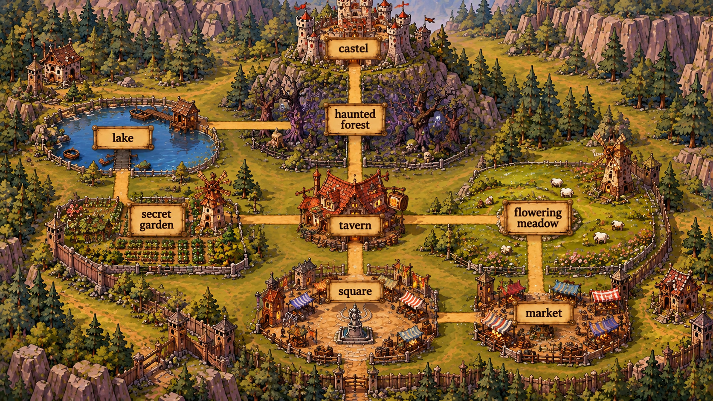

_This project has been created as part of the 42 curriculum by anacharp, frrenaux and tcolson._

# The_Answer_Protocol

## Description

**The Answer Protocol (TAP)** is a text-based, multiplayer adventure game played over TCP. A Go server hosts a shared virtual world (rooms, items, NPCs, quests) and several clients can connect at the same time to explore it, fight hostile NPCs, complete quests, form groups and chat.

The project is made of three parts:

- **Server**: holds the world state and implements the protocol.
- **CLI client**: a colored terminal client with command history (arrow keys).
- **GUI client**: a graphical client built with Fyne.

The protocol is line-based: every message is a single UTF-8 line terminated by `\n`. The server answers with lines starting with `OK`, `ERR` or `EVT` (asynchronous events pushed to players).

## Instructions

### Requirements

- Go (see `go.mod` for the version)
- `make`
- GUI only: the dependencies required by [Fyne](https://docs.fyne.io/)

### Installation

Install `go.mod` depedencies:
```bash
make install
```

### Run

Server (listens on `:8080`):
```bash
go run ./cmd/server
```

GUI:
```bash
go run ./cmd/gui
```

CLI:
```bash
go run ./cmd/cli
```

With the Makefile:
```bash
make server
make cli
make gui
```

The server can be stopped with `Ctrl+C`, or by typing `stop`, `quit` or `exit` in its terminal.
Use `Ctrl+C` (not `Ctrl+Z`) to stop it: a suspended process keeps port 8080 busy.

## Architecture

```
.
├── cmd/
│   ├── server/   # server entry point (listener, shutdown handling)
│   ├── cli/      # terminal client
│   └── gui/      # graphical client
├── client/       # connection library shared by the CLI and the GUI
├── game/         # world model (rooms, items, NPCs, quests) and world loading
├── server/       # connection handling, dispatcher, command handlers
├── data/         # world.json and map
└── Makefile
└── go.mod
└── go.sum
└── README.md
```

### Dispatcher

All commands go through a single `Dispatcher` (`server/dispatcher.go`). It keeps a map `command name -> handler` (`CommandFunc`), filled in `registerCommands()`.

For each line received, `Dispatch`:

1. splits the line into words and upper-cases the command (`GROUP` commands use two words, e.g. `GROUP CREATE`),
2. applies the anti-spam rule on `CHAT`,
3. checks the player's status: during a fight (`combat`), only `ATTACK`, `DEFEND`, `FLEE`, `STATUS`, `USE_ITEM` and `INVENTORY` are allowed,
4. calls the matching handler, or answers an unknown-command error.
This design was chosen over inline handling in the connection loop because adding a command only means writing a handler and registering it, and because the connection code stays independent of the game rules.

### Concurrency model

- **One goroutine per connection** (`HandleConnection`), started by the accept loop in `Server`.
- The shared state (clients, groups, world) is protected by a single mutex, `Dispatcher.mu`. Handlers that read or modify the world lock it.
- The number of connections is tracked with a counter and limited to 30 (`ERR 019 SERVER_FULL` beyond that).
- Cleanup (removing the player from the room, dropping the inventory, updating stats) is done in one place: a `defer` in `HandleConnection`. It runs whether the player typed `QUIT`, closed the terminal, or lost the connection.
- Graceful shutdown: `Ctrl+C` / `SIGTERM` / the `stop` command close the listener, which makes the accept loop return.
### TCP stream handling

TCP is a stream of bytes, not a stream of messages. The server reads with a `bufio.Reader` and only processes a command once the terminating `\n` has arrived:

- **Fragmentation**: a command split across several packets is buffered until the full line is received. Test with `(printf 'CONNECT bob\n'; printf 'lo'; sleep 2; printf 'ok\n') | nc localhost 8080`
- **Coalescence**: several commands received in one packet are processed one by one. Test with `printf 'CONNECT bob\nlook\nwho\n' | nc localhost 8080`
- **Line limit**: lines longer than 1024 bytes are discarded and answered with `ERR 016 LINE_TOO_LONG`, without closing the connection.
### Resource limits

| Limit | Value |
|-------|-------|
| Line length | 1024 bytes |
| Simultaneous connections | 30 |
| Inventory size | 100 items |
| Chat frequency | 1 message per 2 seconds per player |
| Username length | 20 char |

### Client side

The `client` package opens the connection, reads server lines in a goroutine and exposes them through a `Messages()` channel. `Close()` is idempotent and a `done` channel prevents the reader goroutine from blocking when nobody reads anymore.

The CLI puts the terminal in raw mode (`golang.org/x/term`) to handle the history with the up/down arrows, and prints server messages without breaking the line being typed.

## Protocole Implementation

### Commands (current state)

| Command | Success response | Error responses | Events pushed |
|---|---|---|---|
| *(on connect)* | `OK hello proto=1` | none | none |
| any command before `CONNECT` | | `ERR 002 YOU_MUST_BE_CONNECTED` | |
| `CONNECT <name>` | `OK connected` | `ERR 010 YOU_HAVE_A_NAME`, `ERR 009 THIS_IS_NOT_A_NAME`, `ERR 201 NAME_IN_USE`, `ERR 021 NAME_TOO_LONG` | none |
| `QUIT` | `OK bye` | | none |
| `LOOK` | `OK look={"room": {"Id":"loc.square","Name":"Village Square","Description":"A bustling square.","Exits":{"east":"loc.market","north":"loc.forest"},"Players":["arbre"],"Items":["item.herbs","item.herbs"],"NPCs":["npc.village_guard"]}}` | | |
| `MOVE <direction>` | `OK room=<room-id>` | `ERR 301 NO_EXIT` | none |
| `TAKE <item id or name>` | `OK taken=<item-id>` | `ERR 007 ITEM_NOT_OBTAINABLE`, `ERR 404 ITEM_NOT_FOUND`, `ERR 017 FULL_INVENTORY` | `"EVT PLAYER TOOK <item_id>` |
| `DROP <item id or name>` | `OK dropped=<item-id>` | `ERR 404 ITEM_NOT_FOUND` | `"EVT PLAYER DROPPED <item_id>` |
| `INVENTORY` | `OK inventory=[item.a item.b]` | | |
| `TALK <npc id or name>` | `OK talk=<npc_id>: <dialogue line>` | `ERR 404 NPC_NOT_FOUND` | |
| `STATUS` | `OK status={"hp": <client_hp>, "max_hp": <client_maxp_hp>, "status": "<client_status>"}` | | none |
| `ATTACK <npc id or name>` | `OK attack={"player_hp": 36, "player_max_hp": 100, "NPC_name": "Robber", "NPC_hp": 1, "NPC_max_hp": 100, "damage": 8, "damage_type": "normal", "status": "combat"}`, `OK attack=<ncp_id>=dead, "status"="<client_status>"`, `GAME OVER` | `ERR 404 NPC_NOT_FOUND`, `ERR 405 NPC_NOT_HOSTILE`, `ERR 014 NPC_IN_FIGHT` | `EVT NPC <npc_id> DEAD`, `EVT NPC FLEE, "status"="<player_status>"`, `EVT NPC ATTACK`, `EVT NPC REGENERATION : +5 hp`, `EVT POISON : -5 npc hp during <nb_turns> turns`, `EVT Strength : +5 player strength during <nb_turns> turns`, `EVT HEALTH : +5 player hp during <nb_turns> turns`, `EVT POISON : -5 player hp during <nb_turns> turns` |
| `FLEE` | `OK flee=succed, "status"="<client_status>"`, `OK flee=fail, "status"="combat"`, `GAME OVER` | `ERR 013 NOT_IN_FIGHT` | `EVT NPC ATTACK`, `EVT NPC REGENERATION : +5 hp`, `EVT POISON : -5 npc hp during <nb_turns> turns`, `EVT Strength : +5 player strength during <nb_turns> turns`, `EVT HEALTH : +5 player hp during <nb_turns> turns`, `EVT POISON : -5 player hp during <nb_turns> turns` |
| `DEFEND` | `OK defend, "status"="combat"`, `OK attack={"player_hp": 36, "player_max_hp": 100, "NPC_name": "Robber", "NPC_hp": 1, "NPC_max_hp": 100, "damage": 8, "damage_type": "normal", "status": "combat"}`, `GAME OVER` | `ERR 013 NOT_IN_FIGHT` | `EVT NPC FLEE, "status"="<client_status>"`, `EVT NPC ATTACK`, `EVT NPC REGENERATION : +5 hp`, `EVT POISON : -5 npc hp during <nb_turns> turns`, `EVT Strength : +5 player strength during <nb_turns> turns`, `EVT HEALTH : +5 player hp during <nb_turns> turns`, `EVT POISON : -5 player hp during <nb_turns> turns` |
| `USE_ITEM <item>` | `OK use=<item_id>` | `ERR 012 IN_FIGHT`, `ERR 404 ITEM_NOT_FOUND`, `ERR 013 NOT_IN_FIGHT`, `GAME OVER` | `EVT BEER : -5 player hp during <nb_turns> turns`, `EVT SWORD : +5 player strength during <nb_turns> turns`, `EVT POISON POTION : -5 npc hp during <nb_turns> turns`, `EVT Strength POTION : +5 player strength during <nb_turns> turns`, `EVT HEALTH POTION : +5 player hp during <nb_turns> turns` |
| `WHO` | `OK players=<n>` | | |
| `CHAT GLOBAL <msg>` | `OK` (sender) | `ERR 006 NO_CHAT_SPECIFIED`, `ERR 008 MISSING_MESSAGE`, `ERR 0 SPAM` | `EVT GLOBAL CHAT <username> <message>` to others |
| `CHAT ROOM <msg>` | `OK` (sender) | `ERR 006 NO_CHAT_SPECIFIED`, `ERR 008 MISSING_MESSAGE`, `ERR 018 SPAM` | `EVT ROOM CHAT <username> <message>` to others in room |
| `CHAT GROUP <msg>` | `OK` (sender) | `ERR 401 NOT_IN_GROUP`, `ERR 006 NO_CHAT_SPECIFIED`, `ERR 008 MISSING_MESSAGE`, `ERR 018 SPAM` | `EVT GROUP CHAT <username> <message>` to group members |
| `GROUP CREATE <id>` | `OK group_created=<id>` | `ERR 402 ALREADY_IN_GROUP` | none |
| `GROUP INVITE <user>` | `OK group_invited=<username>` | `ERR 003 CANT_FIND_USER`, `ERR 402 ALREADY_IN_GROUP`, `ERR 022 NOT_LEADER` | `EVT GROUP INVITE <leadername>` to the invited user |
| `GROUP JOIN <leader>` | `OK group_joined=<id>` | `ERR 402 ALREADY_IN_GROUP`, `ERR 003 CANT_FIND_LEADER`, `ERR 004 THIS_USER_IS_NOT_A_LEADER`, `ERR 005 REQUIRE_INVITATION` | `EVT GROUP JOIN <username>` to members |
| `GROUP LEAVE` | `OK GROUP LEAVE <group_id>` | `ERR 401 NOT_IN_GROUP` | `EVT group_leave=<username>` to remaining members |
| `INFO_GROUP` | `OK group_infos={"group": {"Id":"<group_ID>", "Leader":"group_Leader", "Members":"[<username> <username> <username>]", "Invited":"[<username>]"}` | `ERR 401 NOT_IN_GROUP` | none |
| `QUEST <npc name or npc id>` | `OK quest={"quest_npc": "jewelry_merchant", "quest_id": "princess_necklace", "description": "Bring me a beautiful necklace please.", "reward": "Bravery", "status": "available"}` | `ERR 015 NO_QUEST_AVAILABLE`, `ERR 404 NPC_NOT_FOUND` | `EVT QUEST took=<quest_id>` |
| `QUESTS` | `OK quests=[]`, `OK quests=[{"quest_npc": "princess", "quest_id": "princess_necklace", "status": "active", "progress": "0/1"}, {"quest_id": "example", "status": "completed"}]` | none | none |
| `COMPLETE_QUEST <quest_id>` | `OK complete_quest=quest_id: completed`, `OK taken=item.potion`, `"OK gave=<item_id>"` | `ERR 015 NO_QUEST_AVAILABLE`, `ERR 011 INCOMPLETE_QUEST_REQUIREMENTS`, `ERR 404 NPC_NOT_FOUND`, `ERR 017 FULL_INVENTORY` | `EVT QUEST completed=<quest_id>` |
| `ABANDON_QUEST <quest_id>` | `OK abandoned=<quest_id>` | `ERR 015 NO_QUEST_AVAILABLE` | `EVT QUEST abandoned=<quest_id>` |
| `FIND_QUESTS` | `OK find_quests={"quests":[{"npc":"Bartender","quests":["kill_pirate","kill_captain"]}]}` | `ERR 015 NO_QUEST_AVAILABLE` | none |
| UNKNOWN COMMAND | | `ERR 001 UNKNOWN_COMMAND`| none |
| error CLI or GUI connection | | `ERR 900 CONNECTION_FAILED` | none |
| error CLI or GUI send | | `ERR 901 SEND_FAILED` | none |
| error line too long | | `ERR 016 LINE_TOO_LONG` | none |
| error server full | | `ERR 019 SERVER_FULL` | none |
| invalid input error | | `ERR 020 INVALID_INPUT` | none |
| when someone CONNECT himself or QUIT | | | everyone receive `EVT STATS players=nb_players_in_game` and `EVT STATS players_in_room=nb_players_in_his_room` |

### Error codes

| Code | Name | Source |
|------|------|--------|
| 201 | NAME_IN_USE | RFC |
| 301 | NO_EXIT | RFC |
| 401 | NOT_IN_GROUP | RFC |
| 402 | ALREADY_IN_GROUP | RFC |
| 404 | ITEM_NOT_FOUND / NPC_NOT_FOUND / ITEM_NOT_IN_INVENTORY | RFC |
| 405 | NPC_NOT_HOSTILE | RFC |
| 900 | CONNECTION_FAILED | RFC |
| 901 | SEND_FAILED | RFC |
| 001  | UNKNOWN_COMMAND | **custom (not in RFC)** |
| 002 | YOU_MUST_BE_CONNECTED | **custom (not in RFC)** |
| 003 | CANT_FIND_USER | **custom (not in RFC)** |
| 004 | THIS_USER_IS_NOT_A_LEADER | **custom (not in RFC)** |
| 005 | REQUIRE_INVITATION | **custom (not in RFC)** |
| 006 | NO_CHAT_SPECIFIED | **custom (not in RFC)** |
| 007 | ITEM_NOT_OBTAINABLE | **custom (not in RFC)** |
| 008 | MISSING_MESSAGE | **custom (not in RFC)** |
| 009 | THIS_IS_NOT_A_NAME | **custom (not in RFC)** |
| 010 | YOU_HAVE_A_NAME | **custom (not in RFC)** |
| 011 | INCOMPLETE_QUEST_REQUIREMENTS | **custom (not in RFC)** |
| 012 | IN_FIGHT | **custom (not in RFC)** |
| 013 | NOT_IN_FIGHT | **custom (not in RFC)** |
| 014 | NPC_IN_FIGHT | **custom (not in RFC)** |
| 015 | NO_QUEST_AVAILABLE | **custom (not in RFC)** |
| 016 | LINE_TOO_LONG | **custom (not in RFC)** |
| 017 | FULL_INVENTORY | **custom (not in RFC)** |
| 018 | SPAM | **custom (not in RFC)** |
| 019 | SERVER_FULL | **custom (not in RFC)** |
| 020 | INVALID_INPUT | **custom (not in RFC)** |
| 021 | NAME_TOO_LONG | **custom (not in RFC)** |
| 022 | NOT_LEADER | **custom (not in RFC)** |
| 500 | INTERNAL | **custom (not in RFC)** |

### Events

| Event | Format | Source |
|-------|--------|--------|
| Group invitation | `EVT GROUP INVITE <leader>` | RFC |
| Group join | `EVT GROUP JOIN <username>` | RFC |
| Group leave | `EVT GROUP LEAVE <username>` | RFC |
| Chat | `EVT <SCOPE> CHAT <username> <message>` | RFC |
| Room presence | `EVT ROOM PRESENCE ENTER/LEAVE <username>` | RFC |
| Stats | `EVT STATS players=<nb_player>` | RFC |
| Stats | `EVT STATS players_in_room=<nb_player>` | **custom (not in RFC)** |
| NPC Death | `EVT NPC DEAD <npc_id>` | **custom (not in RFC)** |
| NPC Flee | `EVT NPC FLEE, "status"="<npc_id>"` | **custom (not in RFC)** |
| NPC Attack | `EVT NPC ATTACK` | **custom (not in RFC)** |
| NPC Regeneration | `EVT NPC REGENERATION : +5 hp` | **custom (not in RFC)** |
| I am dead | `EVT PLAYER DEATH` | **custom (not in RFC)** |
| A player is dead | `EVT PLAYER DEAD <player_name>` | **custom (not in RFC)** |
| Use_item beer | `EVT BEER : -5 player hp during <nb_turns> turns` | **custom (not in RFC)** |
| Use_item sword | `EVT SWORD : +5 player strength during <nb_turns> turns` | **custom (not in RFC)** |
| Use_item poison potion | `EVT POISON POTION : -5 npc hp during <nb_turns> turns` | **custom (not in RFC)** |
| Use_item strength potion | `EVT Strength POTION : +5 player strength during <nb_turns> turns` | **custom (not in RFC)** |
| Use_item health potion | `EVT HEALTH POTION : +5 player hp during <nb_turns> turns` | **custom (not in RFC)** |
| Poison npc turns | `EVT POISON : -5 npc hp during <nb_turns> turns` | **custom (not in RFC)** |
| Strength turns | `EVT Strength : +5 player strength during <nb_turns> turns` | **custom (not in RFC)** |
| Health turns | `EVT HEALTH : +5 player hp during <nb_turns> turns` | **custom (not in RFC)** |
| Poison player turns | `EVT POISON : -5 player hp during <nb_turns> turns` | **custom (not in RFC)** |
| A player abandon a quest | `EVT QUEST abandoned=<quest_id>` | **custom (not in RFC)** |
| A player complete a quest | `EVT QUEST completed=<quest_id>` | **custom (not in RFC)** |
| A player take a quest | `EVT QUEST took=<quest_id>` | **custom (not in RFC)** |

### Game Over
`GAME OVER`
If a player die, he respawn with less hp. If he dies too many times that we can't take off his HP, he is GAME OVER.\
He is disconnected from the server.

## Combat System

To attack an NPC, it has to be hostile and in the same room as the player.\
The player uses `ATTACK <NPC_id>` to start a fight, and is always the first to strike.\
Fighting an NPC changes the player's status from `exploration` to `combat`.\
While in combat, the player can only use `DEFEND`, `FLEE`, `INVENTORY`, `STATUS` and `USE_ITEM <item_id>`. Any other command is refused with `ERR 012 IN_FIGHT`.

- `ATTACK`: hits the NPC and reduces its HP. There is a 10% chance of a critical hit, which increases the player's strength by 40% for that hit.
- `DEFEND`: protects the player from the NPC's action. If the NPC hits back, its strength is reduced by 40%.
- `FLEE`: the player has a 40% chance to succeed.
- `USE_ITEM`: the player can use items, which activate a buff or a debuff:
	- beer: debuff, the player is poisoned for 3 turns
	- health potion: buff, regenerates the player's HP for 4 turns
	- strength potion: buff, increases the player's strength for 4 turns
	- sword: buff, increases the player's strength for 10 turns
	- poison potion: buff, deals 5 damage to the NPC for 5 turns
- `STATUS`: shows the player's HP, maximum HP and status.
- `INVENTORY`: lets the player check which items can be used in the fight.

After `ATTACK`, `DEFEND`, `FLEE` and `USE_ITEM`, the NPC reacts. It has 3 choices:
- regenerate 5 HP,
- attack the player (10% chance of a critical hit),
- or flee (always succeeds).

Depending on the player's action, the probabilities change:

| Player action | NPC flees | NPC attacks | NPC regenerates |
|---|---|---|---|
| `ATTACK` | 10% | 80% | 10% |
| `DEFEND` | 5% | 75% | 20% |
| `FLEE` | 0% | 95% | 5% |
| `USE_ITEM` | 5% | 55% | 40% |

Once a player attacks an NPC, no other player can join the fight. The fight ends only when the player or the NPC flees, or when one of them dies. It also ends if the player quit the game.

A player who dies respawns in the tavern.

## Quest System

A player can list the available quests of his room with `FIND_QUESTS`.\
If he is in the same room as an NPC that has an available quest, he takes it with `QUEST <npc_id>`. The answer gives the NPC, a description of what to do, the reward, etc.\
A quest can ask to bring items, to kill an NPC, or both.\
Taking a quest makes it unavailable for the other players, unless it is abandoned with `ABANDON_QUEST <quest_id>`.\
`QUESTS` shows the progress on the quests taken and the status (`active` or `completed`) of each.\
When the player has everything required, he goes back to the NPC and uses `COMPLETE_QUEST <quest_id>`. The required items are given to the NPC (they are no longer available in the game) and the rewards go directly into his inventory.\
For now, a completed quest is not available again for another player: it no longer exists.

## World Design



### World layout and room connections

The player spawns and respawns in the tavern, in the middle of the map.\
From there, he can go to the flowering meadow, the square, the secret garden or the haunted forest.\
The haunted forest and the secret garden are linked to the lake.\
The square is linked to the tavern and the market. \
The flowering meadow is linked to the tavern and the market too.\
Finally, the castle is only linked to the haunted forest.

### NPC Roles

There are two kinds of NPC: hostile ones, and the others. Only hostile NPCs can be fought.

Hostile:
- Pirate
- Captain

Others:
- Witch: gives a quest : 'make_potion' with 'Poison Potion' for reward
- Ghost
- Woman: gives a quest : 'flower_mission' with 'Health Potion' for reward
- Fisherman
- Bartender: gives quests : 'kill_pirate' with 'Gold'x2 for reward and 'kill_captain' with 'Gold'x4 for reward
- Princess: gives quests : 'princess_necklace' with 'Strength Potion' for reward and 'sad_princess' with 'Health Potion' for reward
- Village guard
- Royal guard: gives a quest : 'poor_guard' with 'Strength Potion' for reward
- Jewelry merchant: gives a quest : 'get_necklace' with 'Necklace' for reward
- Food merchant: gives a quest : 'get_fish' with 'Fish' for reward
- Weapon merchant: gives a quest : 'get_sword' with 'Sword' for reward

### Item Distribution

Items: Herbs, Spirit, Necklace, Flower, Fish, Strength Potion, Health Potion, Poison Potion, Sword, Beer, Gold.

Some items can be taken directly in the rooms, others are won by completing a quest.

Every item exists as a unique instance in the world, in one of three states: lying in a room, held in a player's inventory, or dropped back in a room. Items can be taken, dropped, used in a fight (they are then consumed), or given to an NPC for a quest (they are then consumed).

Items can be designated by their id (`item.gold`) or by their name (`Gold`), and multi-word names are supported.

If a player dies or disconnects, his whole inventory is dropped in the room where he is.

An inventory is full at 100 items.

## Security

- **Input size**: lines over 1024 bytes are rejected (`ERR 016 LINE_TOO_LONG`).
- **Anti-spam**: one `CHAT` message every 2 seconds per player (`ERR 018 SPAM`).
- **Connection limit**: 30 players at the same time (`ERR 019 SERVER_FULL`).
- **Unique names**: two players cannot have the same name (`ERR 201 NAME_IN_USE`).
- **Encoding**: messages are UTF-8.

## Server Logging

The server logs with the standard `log/slog` package (`server/logs.go`). Every log line is a **JSON object** written on one line, which makes it easy to parse with `jq` or `grep`.

### Format

```json
{"time":"2026/11/25 11:13:40","level":"INFO","msg":"command","source":"SERVER","player":"h","ip":"10.11.1.5:39316","cmd":"ATTACK","args":["pizza"]}
```

| Field | Meaning |
|---|---|
| `time` | Date and time of the event (`YYYY/MM/DD HH:MM:SS`) |
| `level` | `INFO`, `WARN` or `ERROR` |
| `source` | Who **caused** the event: the player name (or its address before `CONNECT`) for client actions, an NPC id for NPC actions, `SERVER` for what the server itself does (responses, events, start/stop, errors) |
| `msg` | Type of event |
| `ip` | Address of the **client** (`ip:port`), never the server's |
| `player` | The player who **did** the action |
| `to` | The player who **received** a message (only on messages sent by the server) |

### Log levels

| Level | Used for | Examples |
|---|---|---|
| `INFO` | Normal activity | connection, command, response, event, quest, combat |
| `WARN` | A mistake or abuse from the client, handled by the server | `ERR 404`, `ERR 018 SPAM`, line too long, server full |
| `ERROR` | A failure of the **server** itself | `ERR 500 INTERNAL`, recovered panic, send failure, `accept` failure |

A player typing a wrong command can only cause a `WARN`. An `ERROR` always means a bug or a failure on the server side.

### Event types

| `msg` | Level | Description |
|---|---|---|
| `server started` / `server stopped` | INFO | Start and end of the server (with the listening address) |
| `shutdown requested` | INFO | `Ctrl+C`, `SIGTERM`, or `stop`/`quit`/`exit` typed on the server |
| `client connected` / `client disconnected` | INFO | Connection and disconnection, with the client's IP and player name |
| `command` | INFO | Every command received: player, IP, command and arguments |
| `response sent` | INFO | Every `OK` answer sent to a client |
| `error sent` | WARN / ERROR | Every `ERR` answer sent, with its `code` (`ERROR` for `500`) |
| `event sent` | INFO | Every `EVT`, with the event and the **list of players who received it** (`recipients`, `count`) |
| `item taken` / `item dropped` | INFO | Item movements between rooms and inventories |
| `combat` / `npc killed` | INFO | Damage dealt and received, NPC deaths |
| `quest taken` / `quest completed` / `quest abandoned` | INFO | Quest progress |
| `send failed` | ERROR | Writing to a client's connection failed |
| `panic recovered` | ERROR | A handler crashed: only that player is disconnected, the server keeps running (stack trace included) |
| `abuse: chat spam` | WARN | More than one `CHAT` every 2 seconds |
| `abuse: line too long` | WARN | Line over 1024 bytes |
| `abuse: rapid connections` | WARN | Too many connections from the same address in a short time |
| `connection refused: server full` | WARN | More than 30 simultaneous players |

Events sent to several players (presence, stats, chat, group) produce **one** log line, with all the recipients:

```json
{"time":"2026/11/25 11:52:10","level":"INFO","msg":"event sent","source":"SERVER","event":"EVT ROOM PRESENCE ENTER bob","recipients":["alice","carol"],"count":2}
```

### Output

Logs are written on the **standard output** (`stdout`) of the server. To keep a copy in a file:

```bash
make server
```

JSON encoding escapes control characters, so a player name containing terminal escape sequences cannot alter the terminal of the person reading the logs.

### Monitoring and abuse detection

```bash
tail -f server.log                                   # follow the server live
grep '"level":"WARN"'  server.log                    # client mistakes and abuse
grep '"level":"ERROR"' server.log                    # server failures
grep '"msg":"abuse' server.log                       # abuse patterns only
grep '"code":"018"' server.log                       # all spam errors
grep '"msg":"quest' server.log                       # quest activity
grep '"source":"SERVER"' server.log                  # what the server said or did

# with jq
jq 'select(.player=="bob" or .source=="bob")' server.log                 # everything about bob
jq -r 'select(.msg=="client connected") | .ip' server.log | sort | uniq -c | sort -rn   # connections per address
```

Abuse is detected from: chat flooding (`abuse: chat spam`), oversized lines (`abuse: line too long`), repeated connections from the same address (`abuse: rapid connections`), and a full server (`connection refused: server full`). An address appearing many times in these lines in a short time is a sign of abuse.

### Performance

`slog` is thread-safe and writes each line with a single `Write`, so lines from different goroutines are never mixed. The logs are written synchronously to the standard output, which stays fast for the size of this project, and broadcast events are logged once instead of once per recipient.

## Group Contributions

| Task | Details | Group Member |
| ---- | ------- | ------------ |
| Server | TCP server, dispatcher, commands, combat, quests, groups, chat, limits | anacharp |
| CLI client | Connection library, colored display, command history | anacharp |
| GUI client | Fyne interface | frrenaux, tcolson |
| World Design | Map, rooms, NPCs, items, quests (`data/world.json`) | anacharp, frrenaux |

## Building and Running

The Makefile provides one target per component:

```bash
make server   # starts the server on :8080
make cli      # starts the CLI client
make gui      # starts the GUI
```

Always start the server first. The server and the clients must be started from the root of the repository (the server loads `data/world.json`).

To free the port if an old server is still running:

```bash
fuser -k 8080/tcp
```

## Testing

Run the server with the race detector to detect data races while testing:

```bash
go run -race ./cmd/server
```

### Multiplayer

1. Start the server.
2. Open two or more terminals and run `go run ./cmd/cli` in each.
3. `CONNECT alice` in the first one, `CONNECT bob` in the second.
4. Check the events: `EVT STATS players=2`, `EVT STATS players_in_room=2`, `EVT ROOM PRESENCE ENTER bob`.
5. Test `WHO`, `LOOK` (both players are listed), `CHAT GLOBAL`, `CHAT ROOM`.
6. Groups: `GROUP CREATE team`, `GROUP INVITE bob`, then `GROUP JOIN alice` on bob's side, `INFO_GROUP`, `CHAT GROUP`, `GROUP LEAVE`.
7. Check the errors: same name twice (`ERR 201`), two `CHAT` in less than 2 seconds (`ERR 018`).
8. Quit one client with `QUIT`, then by closing its terminal: the other one must receive the updated stats.

### Combat

1. Go to a room with a hostile NPC (pirate, captain) and `ATTACK <npc>`.
2. Check that other commands are refused (`ERR 012 IN_FIGHT`) and that `DEFEND`, `FLEE`, `STATUS`, `INVENTORY` and `USE_ITEM` are accepted.
3. Attack a non-hostile NPC: `ERR 405`. Attack an NPC already in a fight: `ERR 014`.
4. Use each consumable and check the buff/debuff events.
5. Let the player die: inventory dropped in the room, respawn in the tavern.
### Quests

1. `FIND_QUESTS`, then `QUEST <npc>`.
2. `QUESTS` shows the quest as `active` with its progress.
3. With a second player, check that the quest is no longer available.
4. `ABANDON_QUEST <id>`, then check that it is available again.
5. Collect the required items, return to the NPC and `COMPLETE_QUEST <id>`: items consumed, rewards received.
6. `COMPLETE_QUEST` without the items: `ERR 011`.

### Protocol (TCP stream)

These tests use `nc` and `printf` because the CLI always sends complete lines.

Fragmentation (a command received in two pieces, the answer must only come after the `\n`):
```bash
(printf 'CONNECT bob\n'; sleep 1; printf 'lo'; sleep 2; printf 'ok\n'; sleep 1) | nc localhost 8080
```

Coalescence (two commands in one packet, two answers expected):
```bash
(printf 'CONNECT bob\n'; sleep 1; printf 'look\nwho\n'; sleep 1) | nc localhost 8080
```

Line too long (answer `ERR 016 LINE_TOO_LONG`, connection kept open):
```bash
(printf 'CONNECT bob\n'; sleep 1; head -c 2000 /dev/zero | tr '\0' 'a'; printf '\n'; sleep 1) | nc localhost 8080
```

## Resources

### Documentation
#### GoLang
- [Cours: Apprendre GoLang](https://devopssec.fr/category/apprendre-golang)
- [Go by Example](https://gobyexample.com/)
- [A Tour of Go](https://fr-go-dev.shuijingwanwq.com/tour/flowcontrol/8)
- [Les fondamentaux de Go - Organisation d'un projet](https://go-start.vercel.app/fr/chapter-1-introduction/1-4-project-layout/)
- [Les fondamentaux de Go - Commandes essentielles](https://go-start.vercel.app/fr/chapter-1-introduction/1-5-essential-commands/)
- [Go by Example: Time](https://gobyexample.com/time)
#### Server
- [Qu'est-ce que le protocole TCP/IP de contrôle de la transmission ?](https://www.fortinet.com/fr/resources/cyberglossary/tcp-ip)
- [Build a Blazing-Fast TCP Server in Go: A Practical Guide](https://dev.to/jones_charles_ad50858dbc0/build-a-blazing-fast-tcp-server-in-go-a-practical-guide-29d)
- [Go by Example: TCP Server](https://gobyexample.com/tcp-server)
- [Les fondamentaux de Go - Serveur TCP](https://go-start.vercel.app/fr/chapter-10-cli-mastery-build-a-publishable-task-manager/10-17-tcp-server/)
- [Package net](https://pkg.go.dev/net)
- [JSON and Go](https://go.dev/blog/json)
- [Switch](https://go.dev/tour/flowcontrol/9)
- [Goroutines](https://go.dev/tour/concurrency/1)
- [Channels](https://go.dev/tour/concurrency/2)
- [Buffered Channels](https://go.dev/tour/concurrency/3)
#### Client
- [What is the net.DialTimeout function in Golang?](https://www.educative.io/answers/what-is-the-netdialtimeout-function-in-golang)
- [Package golang.org/x/term](https://pkg.go.dev/golang.org/x/term)
#### GUI
- [Package Fyne](https://docs.fyne.io/)
#### Specification
- [RFC 2119](https://www.rfc-editor.org/rfc/rfc2119): MUST / SHOULD / MAY
- [RFC 5234](https://www.rfc-editor.org/rfc/rfc5234): ABNF
- [RFC 793](https://www.rfc-editor.org/rfc/rfc793): TCP
- [RFC 3629](https://www.rfc-editor.org/rfc/rfc3629): UTF-8

### AI Usage

AI was used as a helper for:
- understanding and debugging errors (panic on a nil pointer, import cycle, `null` instead of `[]` in JSON, port already in use, `use of closed network connection`),
- understanding the specification (TCP fragmentation and coalescence, resource management, security considerations),
- suggestions for the clean shutdown of the server and the CLI, the raw-mode input with history, the line size limit and the anti-spam,
- proofreading and restructuring this README.
